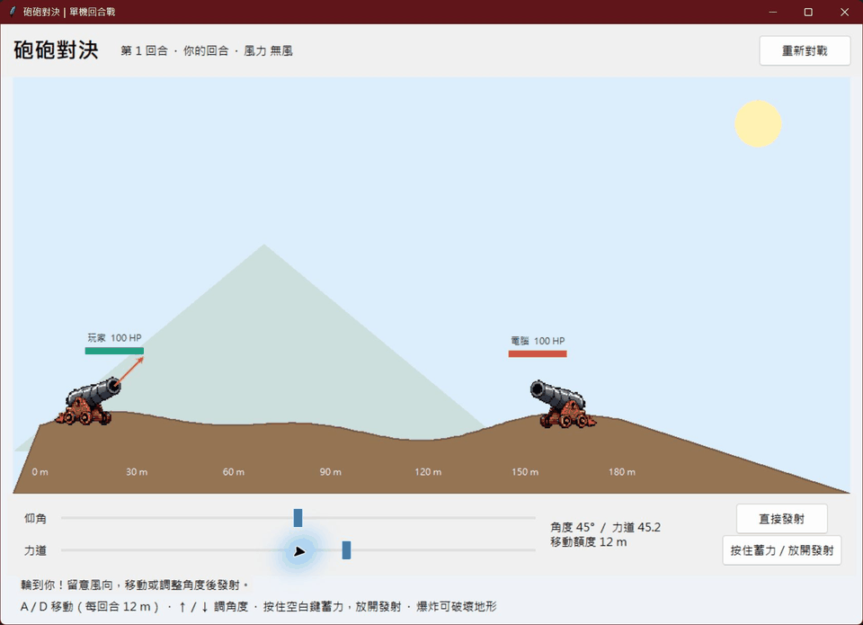

# Python 拋射學習實作與單機砲戰

2026 年 10 月 19 日的 Python 練習：從拋射公式、函式模組、命令列工具，到 Tkinter 視窗與單機回合制砲戰。

## 遊戲展示



## 環境與快速開始

- Python 3.10 以上，含 Tkinter。
- 遊戲與範例使用 Python 標準函式庫，不必安裝 pip 套件。
- Windows 建議使用 Python 官方安裝程式並保留 Tcl/Tk 元件。
- Linux 若缺 Tkinter，可依發行版安裝 `python3-tk`；需要桌面環境。

```bash
git clone https://github.com/kkop345po/python-projectile-lab.git
cd python-projectile-lab
python GUI.py
```

若你的系統使用 `python3` 或 Windows 的 `py`，請替換指令中的 `python`。

## 單機砲戰玩法

玩家與電腦輪流發射砲彈，雙方初始血量為 100。讓電腦血量降到 0 即獲勝；雙方同時倒下則為平手。

- **A / D**：左右移動，每回合最多移動 12 公尺。
- **↑ / ↓**：調整仰角，亦可拖曳角度滑桿。
- **長按空白鍵**：由低至高蓄力；放開立即發射。蓄滿後會維持最大力道。
- **滑鼠蓄力按鈕**：按住蓄力，放開發射。
- **直接發射**：使用目前的角度與力道滑桿數值。
- **重新對戰**：回復血量、地形、參數並重開一局。

留意上方每回合變化的風力。爆炸會造成範圍傷害、破壞部分地形，也可能炸傷自己。飛行時不能移動或修改這一發的設定。動畫以加速時間呈現。

電腦以相同物理公式搜尋候選角度與力道，再加入小幅隨機誤差；這是規則式電腦對手，遊戲不會連線呼叫 AI 或使用 API token。

## 檔案導覽

- `GUI.py`：目前的單機回合制砲戰。
- `GUI_打靶版.py`：五發打靶挑戰，命中靶區得分。
- `GUI_軌跡模擬器.py`：輸入初速度、角度與重力，顯示拋物線、結果與動畫。
- `GUI_元件範例.py`：Tkinter 常見元件、事件、排版、選單、對話框及檔案操作教學。
- `main.py`：斜向拋射 CLI，支援 help、版本、參數驗證及 JSON。
- `test.py`：供 CLI 與模擬器使用的計算模組；名稱雖然叫 test，並非自動測試檔。
- `斜向拋射.py`：固定參數計算指定時間的水平與垂直位置。
- `斜向拋射作業版.py`：計算射程、最大高度及飛行時間。
- `for迴圈.py`：以迴圈逐秒計算位置；此練習未在落地後停止，所以後續可能出現負高度。
- `assets/cannon_display.png`：GUI 使用的透明大砲圖片，請保留此路徑。
- `docs/gameplay.gif`：遊戲視窗的操作示範錄影。

各 GUI 都可以獨立執行，例如：

```bash
python GUI_打靶版.py
python GUI_軌跡模擬器.py
python GUI_元件範例.py
```

## 命令列工具

```bash
python main.py --help
python main.py --version
python main.py -v 30 -a 45
python main.py -v 30 -a 45 -g 1.62
python main.py -v 30 -a 45 --json
```

- `-v / --velocity`：初速度（m/s），必填且大於 0。
- `-a / --angle`：仰角（度），必填且介於 0～90。
- `-g / --gravity`：重力加速度（m/s²），預設 9.81，必須大於 0。
- `--json`：輸出帶單位欄位名稱的 JSON，供其他程式讀取。

預設範例 `-v 30 -a 45` 的結果約為：高度 **22.936 m**、射程 **91.743 m**、時間 **4.325 s**。參數不合法時會顯示錯誤並以狀態碼 2 結束；正常執行為 0。

## 物理公式

計算模組採用無空氣阻力、固定重力、起點與落點等高的模型：

```python
theta = radians(angle)          # 度數轉成弧度
vertical = velocity * sin(theta)
horizontal = velocity * cos(theta)
duration = 2 * vertical / gravity
height = vertical ** 2 / (2 * gravity)
distance = horizontal * duration
```

單機砲戰另外使用固定重力 `15`、水平風加速度、地形碰撞與範圍傷害，以可玩性為目標。其位置公式為：

```python
x = x0 + vx * t + wind * t ** 2 / 2
y = y0 + vy * t - gravity * t ** 2 / 2
```

砲戰的數值與 CLI 的地球重力設定不同，請勿當作精確的現實彈道模型。

## 常見問題

**找不到 tkinter**：先執行 `python -m tkinter` 確認；若缺少，需補裝 Python 的 Tcl/Tk 元件或系統的 Tkinter 套件。

**找不到圖片**：請下載完整儲存庫，保留 `assets/cannon_display.png`，不要只下載 `GUI.py`。

**鍵盤沒反應**：先點一下遊戲畫布，確認目前是玩家回合。

**Windows 終端機中文字亂碼**：可改用 `python -X utf8 main.py -v 30 -a 45`。

**想在 GitHub 網頁直接玩**：本專案是桌面 Tkinter 程式，需下載後用 Python 執行，GitHub Pages 無法直接執行。

## 素材與專案範圍

大砲素材由使用者提供參考圖，再經去背及相容性處理。這是獨立的 Python 教學實作，玩法參考回合制砲戰，未使用《彈彈堂》的程式或官方素材。倉庫未另行授予程式或圖片的開源授權。

本倉庫只收錄當天的 Python 練習與必要素材，不包含個人 API 憑證、下載的 token 檔、快取或其他網路服務設定。

